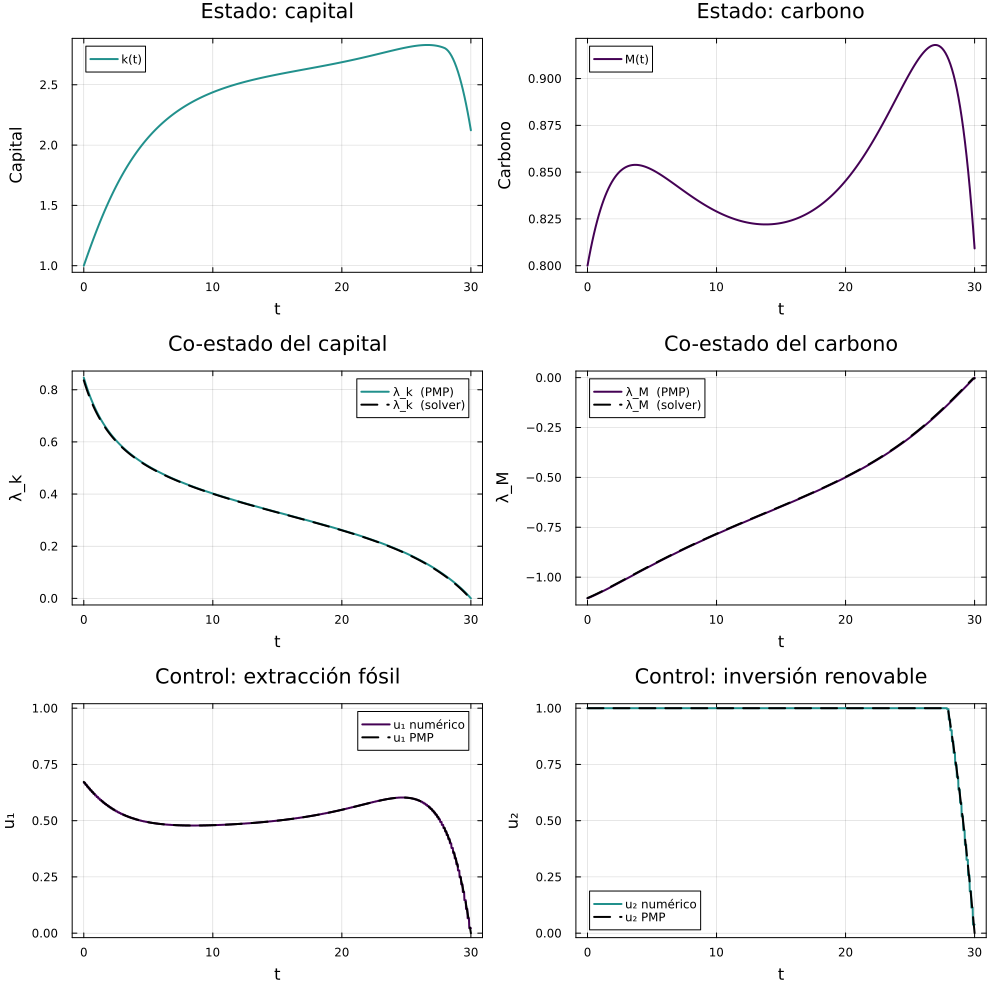
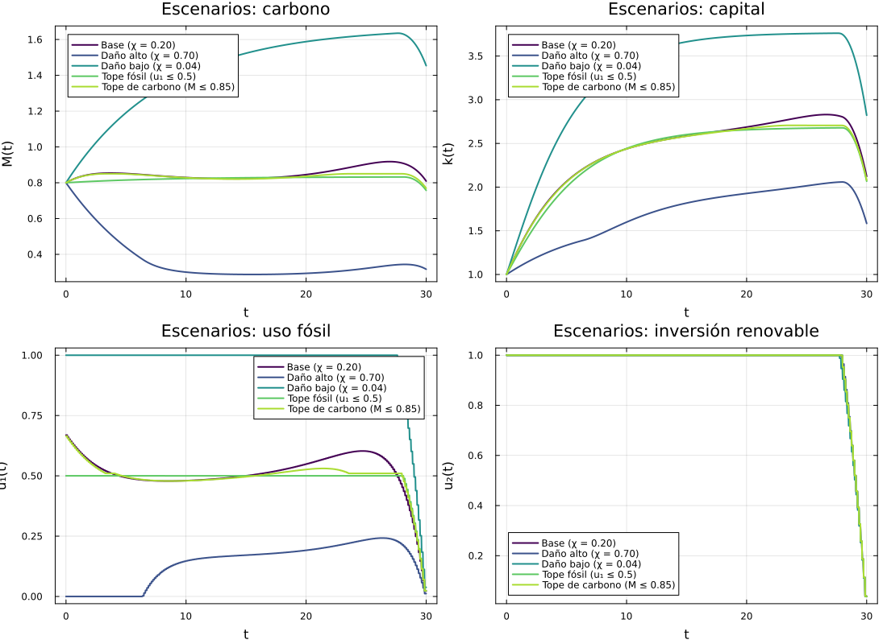
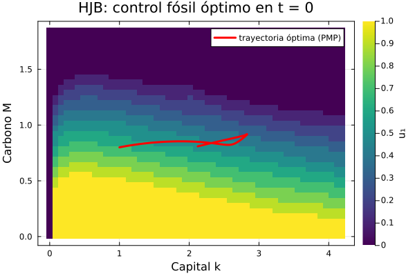

# Control óptimo para la transición energética

Proyecto del curso **MA4703 – Control Óptimo**, Departamento de Ingeniería Matemática, Facultad de Ciencias Físicas y Matemáticas, **Universidad de Chile**.

**Autores:** María Rubio e Ignacio Romero Orrego.

## Descripción

Este proyecto estudia la **transición energética** mediante un modelo macroeconómico-climático con dos fuentes de energía: fósil y renovable. Se busca determinar una política de uso energético que maximice el bienestar social a lo largo de un horizonte finito, considerando la producción, el consumo, la acumulación de carbono y los costos asociados a cada fuente de energía.

El análisis combina simulaciones de ecuaciones diferenciales, herramientas de control óptimo y métodos numéricos implementados en **Julia**. Se contrastan las soluciones obtenidas con el **Principio del Máximo de Pontryagin (PMP)** y con la ecuación de **Hamilton–Jacobi–Bellman (HJB)**.

## Modelo

Las variables de estado son:

- $k(t)$: capital acumulado.
- $M(t)$: carbono acumulado.

Los controles son:

- $u_1(t)$: uso de energía fósil.
- $u_2(t)$: uso de energía renovable.

La dinámica del sistema es:

$$
\begin{aligned}
\dot{k}(t) &= a\frac{k(t)}{1+k(t)}\big(u_1(t)+\eta u_2(t)\big)-(c+\delta)k(t),\\
\dot{M}(t) &= \beta u_1(t)-\sigma M(t).
\end{aligned}
$$

Se maximiza el bienestar social descontado:

$$
J=\int_0^T e^{-\rho t}\left[\log(1+ck(t))-\frac{\chi}{2}M(t)^2-\frac{q_1}{2}u_1(t)^2-\frac{q_2}{2}u_2(t)^2\right]dt,
$$

sujeto a las ecuaciones de estado y a restricciones sobre los controles y estados.

Los parámetros del notebook son **ilustrativos** y no corresponden a una calibración empírica de una economía específica.

## Contenido del notebook

1. **Configuración:** parámetros, bibliotecas y condiciones iniciales.
2. **Análisis cualitativo:** comparación de estrategias energéticas, positividad, cota del carbono y estados estacionarios.
3. **Linealización:** controlabilidad, observabilidad y estabilidad local.
4. **Formulación del problema:** función objetivo, restricciones y condiciones del PMP.
5. **Resolución numérica:** optimización con `OptimalControl.jl` e `Ipopt`, reconstrucción de co-estados y controles, y cálculo del costo social del carbono.
6. **Escenarios de política:** daño climático alto y bajo, límite al uso fósil y límite al carbono acumulado.
7. **Convergencia de malla:** comparación de resultados con distintas discretizaciones.
8. **Función valor y HJB:** programación dinámica sobre una grilla y comparación con el PMP.
9. **Conclusiones:** interpretación de las políticas y limitaciones del modelo.

## Estructura del repositorio

```text
Transicion_energetica/
├── README.md
├── codigo_Transicion_Energetica_Control_Optimo.ipynb
└── figuras/
    ├── estrategias_estados.png
    ├── cota_carbono.png
    ├── fig_estados.png
    ├── fig_coestados.png
    ├── fig_controles.png
    ├── fig_scc.png
    ├── fig_trayectorias_optimas.png
    ├── fig_nativo_OptimalControl.png
    ├── fig_escenarios.png
    ├── fig_malla.png
    └── hjb_politica_fosil.png
```

La carpeta **`figuras/`** contiene los gráficos generados por el notebook. Si no existe, el propio código la crea al ejecutarse.

## Requisitos

- **Julia 1.12** (el notebook indica que fue probado con Julia 1.12 y `OptimalControl` 2.0.4).
- **Jupyter Notebook**, **JupyterLab** o un editor compatible con notebooks de Julia, con el kernel de Julia configurado.
- Paquetes de Julia:
  - `DifferentialEquations`
  - `Plots`
  - `OptimalControl`
  - `NLPModelsIpopt`
  - `Ipopt`

`LinearAlgebra` y `Printf` forman parte de las bibliotecas estándar de Julia.

Para instalar las dependencias, ejecuta en Julia:

```julia
using Pkg
Pkg.add(["DifferentialEquations", "Plots", "OptimalControl", "NLPModelsIpopt", "Ipopt"])
```

## Ejecución

1. Descarga o clona el repositorio:

   ```bash
   git clone https://github.com/MariaRubioP/Transicion_energetica.git
   cd Transicion_energetica
   ```

2. Abre `codigo_Transicion_Energetica_Control_Optimo.ipynb` con un entorno que disponga del kernel de Julia.
3. Ejecuta las celdas **en orden**, desde la configuración de parámetros hasta las conclusiones.
4. Consulta los resultados numéricos en las salidas del notebook y los gráficos en la carpeta `figuras/`.

**Nota:** la optimización de varios escenarios, las pruebas de convergencia y el cálculo de la HJB pueden requerir más tiempo de ejecución que las simulaciones iniciales.

## Figuras destacadas

**Trayectorias óptimas de estados, co-estados y controles**



**Comparación de escenarios climáticos y de política**



**Política fósil mediante HJB**



## Alcance

El proyecto tiene fines **académicos y demostrativos**. Los resultados dependen de las formas funcionales, los parámetros y la discretización elegidos; no deben interpretarse como recomendaciones directas de política energética.
